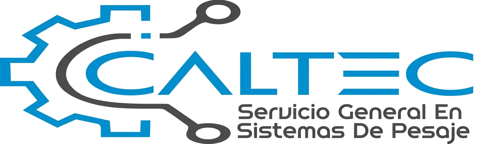

<p align="center">
  
</p>

<div align="center">
  <h1>Sistema de Pesaje</h1>
</div>

Sistema de escritorio para el registro de pesajes con báscula RS232: captura
de peso bruto y tara, catálogos, boletas y reportes en PDF, y sincronización
con el sistema web.

Es un producto propio de **AGETIC**, construido sobre la base técnica de
Jacobitus Escritorio (Gradle multi-módulo, JavaFX, `jpackage`, `Config`,
`jacobitus.css`), pero **autónomo**: el módulo `:pesaje` no depende de
`:escritorio` ni de la librería nativa de firma digital, y se compila y se
empaqueta por separado.

## Módulos

| Módulo | Qué es |
|---|---|
| `:pesaje` | La aplicación: Java 17 + JavaFX + SQLite + PDFBox 3 |

## Requisitos

- OpenJDK 17 (o superior) con `jpackage`
- Gradle 7.6.2 (viene con el wrapper del repo)

No hace falta MSYS2/MinGW: este proyecto no compila código nativo.

## Compilar y ejecutar

```bash
./gradlew :pesaje:jar
./gradlew pesaje:run
```

Tests:

```bash
./gradlew :pesaje:test
```

## Instalador

```bash
./gradlew :pesaje:packageApp --app-profile=prod
```

| Sistema | Artefacto |
|---|---|
| Windows | `pesaje/dist/sistema-pesaje-<version>-x64.msi` |
| macOS | `pesaje/dist/sistema-pesaje-<version>-<arch>.pkg` |
| Linux | `pesaje/dist/sistema-pesaje-<version>-x64.deb` |

El MSI incluye el runtime de Java embebido: el cliente no instala Java.

## Documentación

| Documento | Contenido |
|---|---|
| `pesaje/README.md` | Guía de uso, configuración y empaquetado |
| `pesaje/README-WINDOWS.md` | Instalador de Windows (WiX) |
| `odd/tasks/pesaje-java.md` | Documento de la feature: specs, tareas y evidencia |

## Datos

La base SQLite y el `config.json` viven en la carpeta de datos del usuario:
`%APPDATA%\SistemaPesaje` (Windows), `~/Library/Application Support/SistemaPesaje`
(macOS), `~/.local/share/SistemaPesaje` (Linux).
